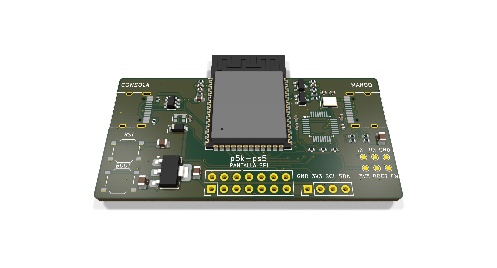

# La placa p5k-ps5

ESP32-S3 y MAX3421E en una sola placa de 62 × 30 mm, con dos USB-C: uno hacia la consola (por el P5Mate) y
otro para el DualSense. Llega montada de JLCPCB: no hay que soldar nada.

**Estado: diseñada y revisada con las herramientas de KiCad, sin fabricar ni probar todavía.** El montaje con
módulos (ESP32-S3 YD + MAX3421E, ver `../caja/`) sí está probado con la PS5.



## Qué lleva

| | |
|---|---|
| Cerebro | ESP32-S3-WROOM-1-N16R8 (el mismo chip que la YD-ESP32-S3), antena fuera del borde |
| Lector del mando | MAX3421EETJ+T (TQFN 5 × 5 mm) con cristal de 12 MHz |
| USB-C CONSOLA | USB nativo del ESP32 (IO19/IO20), protección USBLC6-2SC6, 5,1 kΩ en los CC (recibe corriente) |
| USB-C MANDO | D+/D− del MAX3421E con 33 Ω, 56 kΩ en los CC (da corriente: así el DualSense se carga y se detecta con un cable C a C) |
| Corriente del mando | interruptor (AO3401A + 2N7002) con arranque suave; el GPIO5 a nivel bajo lo apaga, por defecto encendido |
| Alimentación | AMS1117-3.3 desde el VBUS de la consola, con 2 × 22 µF de reserva en VBUS (para el bajón al enchufar el mando en caliente) y pistas de VBUS a 0,6 mm donde caben |
| Extras | BOOT, RST, LED RGB WS2812B (IO48), puntos de prueba TX/RX/GND/3V3/BOOT/EN |
| Pantallas (sin montar) | conector OLED I2C (GND, 3V3, SCL=IO7, SDA=IO6) y conector SPI 2×7 para pantallas a color o táctiles |
| Cara de abajo | QR de p5k-ps5.github.io, sin vías debajo para que se lea |

Los pines del ESP32-S3 son los mismos que en el montaje con módulos (SCK IO12, MOSI IO11, MISO IO13, SS IO10,
INT IO9, RES IO8): el firmware vale tal cual.

Conector SPI de pantalla (J4, pin 1 = cuadrado): 1 3V3 · 2 GND · 3 SCK (IO15) · 4 MOSI (IO16) · 5 MISO (IO17) ·
6 CS (IO18) · 7 DC (IO21) · 8 RST (IO38) · 9 BL (IO14) · 10 CS táctil (IO40) · 11 INT táctil (IO41) · 12 SDA · 13 SCL ·
14 5 V.

## Pedirla en JLCPCB

En `fabricacion/`:

- `puente-gerber.zip`: súbelo en «Añadir archivo Gerber» (PCB/PCBA estándar, 2 capas, 1,6 mm).
- `puente-bom.csv` y `puente-cpl.csv`: al activar «Ensamblaje de PCB» (mínimo 2 placas montadas; el LED D1 se puede dejar sin montar: JLCPCB lo da como «difícil» y lo revisa aparte).

Cambia solo esto de los valores de serie: **Vía Cobertura → Con carpa** y **Via Plating Method → Not Specified**
(el relleno con epoxi viene marcado y no hace falta). El CPL ya lleva corregidos el ESP32 (3,4 mm más abajo), el MAX3421E (−90°) y el diodo D2 (180°), que en el
visor de JLCPCB salían desplazados o girados. Aun así, en la vista previa del montaje mira que cada pieza salga con
el giro correcto, sobre todo el MAX3421E, el LED (su marca de la patilla 1 es diminuta), los USB-C y el regulador: si
alguna no cuadra, se gira ahí mismo.

- **El módulo ESP32 sobresale 6,5 mm por el borde de arriba** (la antena, a propósito). Si JLCPCB añade bordes de
  transporte para montarla, que no sea en ese lado: pídelos en los lados cortos o abajo (en sus notas o cuando lo
  pregunten en la revisión DFM).
- **Existencias:** el MAX3421EETJ+T (C1870151, en TQFN: el TQFP se agotó) y el ESP32-S3-WROOM-1-N16R8 (C2913202) son
  piezas «extended» y el MAX anda escaso: mira que haya antes de pedir. El LED es el WS2812B-2020-V6 (C52917434).

## Uso

- **USB-C CONSOLA** al P5Mate (o al ordenador para grabar el firmware). **USB-C MANDO** al DualSense, con un cable C a C.
- **No enchufes un cargador al puerto MANDO:** ese puerto da corriente, no la recibe, y la de fuera entraría en la placa.
- El puerto MANDO no tiene límite de corriente: un cortocircuito en su cable tira del puerto de la consola y reinicia
  la placa (no la daña). Una revisión futura podría llevar un interruptor con límite (p. ej. SY6280AAC o AP2553).

## Cómo está hecha

Todo se genera con scripts desde `diseno.py`, que es la única fuente de verdad (componentes, patillas y redes):

```bash
cd placa
PY=/Applications/KiCad/KiCad.app/Contents/Frameworks/Python.framework/Versions/3.9/bin/python3.9
python3 tablas.py                 # bibliotecas, reglas de diseño (JLCPCB) y clases de red del proyecto
python3 esquema.py                # puente.kicad_sch (componentes con etiquetas de red en cada patilla)
python3 qr.py                     # qr.json (necesita segno)
$PY pcb.py                        # puente.kicad_pcb: contorno, colocación, serigrafía, QR, planos de masa
$PY importar_rutas.py dsn         # puente.dsn para el trazador
java -jar freerouting-2.5.0.jar -de puente.dsn -do puente.ses -mp 60 --gui.enabled=false
$PY importar_rutas.py ses         # mete las pistas, ensancha VBUS, cose la masa con vías y rellena los planos
python3 fabricacion.py            # Gerber, BOM y CPL
```

O todo de una vez: `./construir.sh` (cada trazado de Freerouting sale algo distinto, pero siempre se comprueba).

Comprobaciones (KiCad 10):

```bash
kicad-cli sch erc puente.kicad_sch                       # 0 infracciones
kicad-cli pcb drc --schematic-parity puente.kicad_pcb    # 0 sin conectar, 0 diferencias con el esquema
```

El DRC deja dos avisos sabidos: la huella del módulo no es idéntica a la de la biblioteca (sus vías térmicas se
amplían a 0,3 mm, el mínimo estándar de JLCPCB) y la serigrafía del módulo se recorta en el borde por donde sale
la antena.

Piezas: todas con número de JLCPCB/LCSC comprobado (`LCSC` en `diseno.py`). El diseño pasó una revisión electrónica independiente (patillajes, pines frente al firmware, USB-C, alimentación, interruptor, números LCSC) sin hallazgos graves; sus recomendaciones de colocación (cristal y desacoplos pegados al MAX, condensadores del regulador, VBUS más ancho, más reserva en VBUS, 10 kΩ en SS) están aplicadas. El patillaje del MAX3421E sale de la
hoja de datos de Maxim (19-3953, «Pin Configurations»); su símbolo está en `puente.kicad_sym`.
